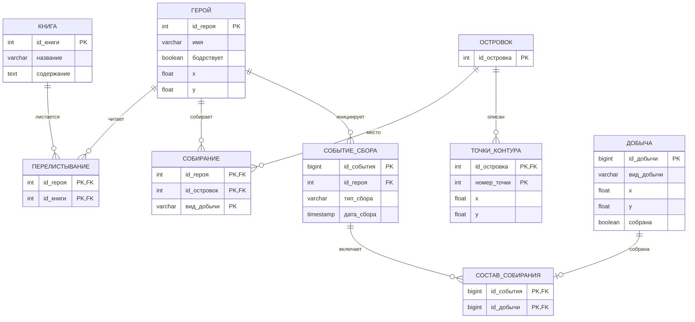

# Лабораторная работа № 3 — решение

**Вариант:** 6543 · **Дисциплина:** Базы данных · **СУБД:** PostgreSQL  
**Автор отчёта:** Сырчин А.Д. · **Группа:** Р3222 · **Преподаватель:** Барсуков М.А.

Текстовая версия предоставленного отчёта. SQL приведён в копируемом Markdown-формате. В конце отдельно отмечены ограничения алгоритмов и расхождения между текстом отчёта и фактической реализацией.

## 1. Предметная область и исходная схема

Предметная область описывает героев, книги, островки, перелистывание книг и сбор добычи двух видов: моллюсков и устриц.

Исходная схема из лабораторной работы № 1:

| Отношение | Атрибуты | Первичный ключ |
|---|---|---|
| Герой | id_героя, имя, бодрствует | id_героя |
| Книга | id_книги, название, содержание | id_книги |
| Островок | id_островка | id_островка |
| Перелистывание | id_героя, id_книги | (id_героя, id_книги) |
| Собирание | id_героя, id_островок, вид_добычи | (id_героя, id_островок, вид_добычи) |

Связь «Перелистывание» реализует отношение M:N между героями и книгами. «Собирание» фиксирует, что конкретный герой собирает конкретный вид добычи на конкретном островке.

### Физическая схема в расширенной реализации

Для пространственной логики и регистрации событий сбора исходная схема была расширена:

- в таблицу «Герой» добавлены координаты x и y;
- создана таблица «Точки_контура» для вершин многоугольников островков;
- создана таблица «Добыча», в которой каждая запись соответствует отдельному ресурсу на карте;
- создана таблица «Событие_сбора» для регистрации ручного сбора и перемещения;
- создана таблица «Состав_собирания» для связи события с конкретными собранными ресурсами.

Таким образом, «Собирание» из исходной модели и «Состав_собирания» из механизма регистрации событий — разные отношения.

## 2. Минимальное множество функциональных зависимостей

Функциональная зависимость X → Y означает: если две строки отношения совпадают по всем атрибутам X, то они обязаны совпадать и по всем атрибутам Y.

### 2.1. Герой

Отношение:

    Герой(id_героя, имя, бодрствует)

Идентификатор героя однозначно определяет его имя и состояние бодрствования:

    id_героя → имя
    id_героя → бодрствует

Минимальное множество:

    F1 = {
        id_героя → имя,
        id_героя → бодрствует
    }

### 2.2. Книга

Отношение:

    Книга(id_книги, название, содержание)

Идентификатор книги определяет её название и содержание:

    id_книги → название
    id_книги → содержание

Минимальное множество:

    F2 = {
        id_книги → название,
        id_книги → содержание
    }

### 2.3. Островок

Отношение:

    Островок(id_островка)

В отношении один атрибут, являющийся первичным ключом. Нетривиальных функциональных зависимостей нет:

    F3 = ∅

### 2.4. Перелистывание

Отношение:

    Перелистывание(id_героя, id_книги)

Первичный ключ — составной:

    PK = (id_героя, id_книги)

Оба атрибута входят в первичный ключ. Неключевых атрибутов нет, поэтому нетривиальных функциональных зависимостей не предполагается:

    F4 = ∅

### 2.5. Собирание

Отношение:

    Собирание(id_героя, id_островок, вид_добычи)

Корректный первичный ключ:

    PK = (id_героя, id_островок, вид_добычи)

Изначально рассматривался ключ (id_героя, id_островок), но он не отражает предметную область: один герой может собирать на одном островке и моллюсков, и устриц. Поэтому вид_добычи также включён в первичный ключ.

Все три атрибута входят в первичный ключ; неключевых атрибутов нет:

    F5 = ∅

### 2.6. Итоговое минимальное множество

Объединяем множества зависимостей:

    F = F1 ∪ F2 ∪ F3 ∪ F4 ∪ F5

В развёрнутом виде:

    F = {
        id_героя → имя,
        id_героя → бодрствует,
        id_книги → название,
        id_книги → содержание
    }

Для «Островка», «Перелистывания» и «Собирания» нет нетривиальных функциональных зависимостей в принятой модели.

Почему множество минимально:

- в правой части каждой зависимости находится один атрибут;
- в левой части каждой зависимости только один атрибут, поэтому удалять из неё нечего;
- ни одна из четырёх зависимостей не выводится из остальных: без соответствующей зависимости нельзя определить атрибут по идентификатору.

## 3. Проверка нормальных форм

### 3.1. Первая нормальная форма — 1NF

Отношение находится в 1NF, если значения его атрибутов атомарны в рамках выбранной предметной области, а повторяющиеся группы значений не хранятся в одной ячейке.

В нашей схеме каждый атрибут строки содержит одно значение:

- имя героя — одно текстовое значение;
- состояние бодрствования — одно логическое значение;
- идентификаторы — отдельные значения;
- вид добычи — одно значение из ограниченного набора.

Списки книг или собранных ресурсов не записываются в одну ячейку: для связей используются отдельные строки таблиц.

Следовательно, отношения исходной схемы находятся в 1NF.

### 3.2. Вторая нормальная форма — 2NF

Отношение находится в 2NF, если оно находится в 1NF и каждый неключевой атрибут полностью функционально зависит от каждого кандидатного ключа. Не должно быть зависимости неключевого атрибута от собственного подмножества составного кандидатного ключа.

- В «Герое» и «Книге» первичные ключи простые, поэтому частичных зависимостей от части ключа быть не может.
- «Островок» не содержит неключевых атрибутов.
- «Перелистывание» содержит только атрибуты составного первичного ключа.
- «Собирание» после корректировки также содержит только атрибуты составного первичного ключа.

Следовательно, частичных зависимостей неключевых атрибутов нет, все отношения находятся в 2NF.

### 3.3. Третья нормальная форма — 3NF

Формальное условие 3NF: для каждой нетривиальной функциональной зависимости X → A выполняется хотя бы одно из условий:

1. X является суперключом;
2. A является простым (prime) атрибутом, то есть входит хотя бы в один кандидатный ключ.

В «Герое» все нетривиальные зависимости имеют вид:

    id_героя → имя
    id_героя → бодрствует

id_героя — первичный ключ, следовательно, суперключ.

В «Книге»:

    id_книги → название
    id_книги → содержание

id_книги — первичный ключ, следовательно, суперключ.

«Островок», «Перелистывание» и «Собирание» не содержат неключевых атрибутов и не имеют нетривиальных зависимостей, нарушающих 3NF.

Итог: все исходные отношения уже находятся в 3NF. Декомпозиция не требуется.

### 3.4. Схема после приведения к 3NF

Схема сохраняет исходный набор отношений:

1. Герой (id_героя — PK, имя, бодрствует).
2. Книга (id_книги — PK, название, содержание).
3. Островок (id_островка — PK).
4. Перелистывание (id_героя — PK/FK, id_книги — PK/FK).
5. Собирание (id_героя — PK/FK, id_островка — PK/FK, вид_добычи — часть PK).

Для вида добычи предусмотрено ограничение CHECK со значениями «моллюски» и «устрицы».

## 4. Изменения функциональных зависимостей после 3NF

Поскольку исходные отношения уже удовлетворяют требованиям 3NF, декомпозиция не проводилась.

| Отношение | Зависимости | Изменения |
|---|---|---|
| Герой | id_героя → имя; id_героя → бодрствует | Не изменились |
| Книга | id_книги → название; id_книги → содержание | Не изменились |
| Островок | Нет нетривиальных зависимостей | Не изменились |
| Перелистывание | Нет нетривиальных зависимостей | Не изменились |
| Собирание | Нет нетривиальных зависимостей | Уточнён состав первичного ключа |

После анализа:

- функциональные зависимости «Героя» и «Книги» остались прежними;
- состав атрибутов отношений не изменился;
- декомпозиция отношений не потребовалась;
- для «Собирания» исправлен первичный ключ: в него включён вид_добычи.

Важно: изменение первичного ключа в «Собирании» — это исправление модели с учётом семантики предметной области, а не результат разложения отношения из-за нарушения 3NF.

## 5. Преобразование в BCNF

BCNF требует, чтобы для каждой нетривиальной функциональной зависимости X → Y детерминант X был суперключом.

### Герой

Единственные нетривиальные зависимости:

    id_героя → имя
    id_героя → бодрствует

id_героя — первичный ключ и суперключ. Следовательно, «Герой» находится в BCNF.

### Книга

    id_книги → название
    id_книги → содержание

id_книги — первичный ключ и суперключ. Следовательно, «Книга» находится в BCNF.

### Островок

Таблица содержит только первичный ключ. Нетривиальных функциональных зависимостей нет. Следовательно, отношение находится в BCNF.

### Перелистывание

Оба атрибута входят в составной первичный ключ. Дополнительных нетривиальных зависимостей не предполагается. Следовательно, отношение находится в BCNF.

### Собирание

    PK = (id_героя, id_островка, вид_добычи)

Все атрибуты входят в состав первичного ключа. Нетривиальных зависимостей с детерминантом, который не является суперключом, нет. Следовательно, отношение находится в BCNF.

### Итог

Все отношения итоговой схемы находятся в BCNF. Дополнительная декомпозиция не требуется; схема после BCNF совпадает со схемой после 3NF.

## 6. Полезные денормализации

Денормализация — намеренное добавление избыточности или предварительно вычисленных данных ради ускорения чтения или упрощения часто используемых запросов. Это обмен части нормализационной чистоты на производительность и более простые запросы. Цена — необходимость поддерживать согласованность дублируемых данных.

### 6.1. Идентификатор островка в таблице Добыча

Предлагается добавить в «Добычу» столбец id_островка.

Принадлежность ресурса островку уже можно определить по координатам ресурса и многоугольнику, заданному таблицей «Точки_контура». Следовательно, id_островка дублировал бы информацию, которую можно вычислить пространственным запросом.

Польза:

- при перемещении героя можно быстрее отбирать ресурсы по островку;
- не требуется каждый раз проверять принадлежность всех рассматриваемых точек многоугольникам;
- можно уменьшить число пространственных вычислений.

Ограничения и поддержание согласованности:

- для ресурса вне островков id_островка может быть NULL;
- при добавлении ресурса и изменении его координат нужно проверять соответствие сохранённого островка геометрии;
- при изменении контура островка нужно решить, как обновлять уже сохранённые идентификаторы;
- если островки могут пересекаться, требуется явно определить правило выбора островка.

**Статус:** эта денормализация описана как предложение. В итоговую таблицу «Добыча» столбец id_островка не добавлялся.

### 6.2. Хранение состояния собрана

В таблицу «Добыча» добавлен атрибут:

    собрана BOOLEAN NOT NULL DEFAULT FALSE

Состояние ресурса можно определить по наличию соответствующей записи в таблице «Состав_собирания». Следовательно, отдельное поле собрана дублирует информацию, которая доступна через связь с записью о сборе.

Польза:

- свободные ресурсы можно отбирать непосредственно по собрана = FALSE;
- не требуется выполнять соединение с таблицей состава сбора при каждом поиске;
- частичный индекс по координатам свободных ресурсов помогает ускорить пространственный поиск.

Поддержание согласованности:

- при добавлении ресурса в «Состав_собирания» состояние меняется на TRUE;
- при удалении соответствующей записи состояние возвращается в FALSE;
- при возврате ресурса на карту обновляются координаты и состояние.

**Статус:** атрибут собрана и триггер синхронизации реализованы.

### 6.3. Индекс свободной добычи

Для поиска ресурсов, которые ещё не собраны, создан частичный индекс:

```sql
CREATE INDEX idx_добыча_свободная
ON добыча (x, y)
WHERE собрана = FALSE;
```

В индекс попадают только свободные ресурсы. Это уменьшает размер индекса по сравнению с индексом по всем строкам, если существенная часть добычи уже собрана.

Индекс не является денормализацией в том же смысле, что дублирующий атрибут собрана: он представляет собой физическую структуру ускорения доступа, а не дополнительный факт предметной области.

## 7. Реализация расширенной модели

Ниже приведены основные структуры, добавленные для пространственного сбора. Предполагается, что таблицы Герой и Островок созданы в предыдущей лабораторной.

### 7.1. Координаты героя

```sql
ALTER TABLE герой
ADD COLUMN x DOUBLE PRECISION,
ADD COLUMN y DOUBLE PRECISION;

ALTER TABLE герой
ADD CONSTRAINT герой_координаты_check
CHECK (
    (x IS NULL AND y IS NULL)
    OR
    (x IS NOT NULL AND y IS NOT NULL)
);
```

Обе координаты либо заданы одновременно, либо одновременно отсутствуют.

### 7.2. Контуры островков

```sql
CREATE TABLE точки_контура (
    id_островка INTEGER NOT NULL
        REFERENCES островок(id_островка)
        ON DELETE CASCADE,
    номер_точки INTEGER NOT NULL
        CHECK (номер_точки > 0),
    x DOUBLE PRECISION NOT NULL,
    y DOUBLE PRECISION NOT NULL,
    PRIMARY KEY (id_островка, номер_точки)
);
```

Островок представляется многоугольником. Порядок вершин задаётся номером точки. Первичный ключ гарантирует, что внутри одного островка номер вершины не повторяется.

### 7.3. Добыча

```sql
CREATE TABLE добыча (
    id_добычи BIGINT GENERATED ALWAYS AS IDENTITY PRIMARY KEY,
    вид_добычи VARCHAR(30) NOT NULL
        CHECK (вид_добычи IN ('моллюски', 'устрицы')),
    x DOUBLE PRECISION NOT NULL,
    y DOUBLE PRECISION NOT NULL,
    собрана BOOLEAN NOT NULL DEFAULT FALSE
);

CREATE INDEX idx_добыча_свободная
ON добыча (x, y)
WHERE собрана = FALSE;
```

Каждая строка описывает отдельный ресурс с уникальным ID, типом и координатами.

### 7.4. Событие сбора

```sql
CREATE TABLE событие_сбора (
    id_события BIGINT GENERATED ALWAYS AS IDENTITY PRIMARY KEY,
    id_героя INTEGER NOT NULL
        REFERENCES герой(id_героя),
    тип_сбора VARCHAR(20) NOT NULL
        CHECK (тип_сбора IN ('ручной', 'перемещение')),
    вид_добычи VARCHAR(30)
        CHECK (вид_добычи IN ('моллюски', 'устрицы')),
    количество_запрошено INTEGER,
    x_начало DOUBLE PRECISION,
    y_начало DOUBLE PRECISION,
    x_конец DOUBLE PRECISION,
    y_конец DOUBLE PRECISION,
    дата_сбора TIMESTAMP NOT NULL DEFAULT CURRENT_TIMESTAMP,
    CONSTRAINT событие_сбора_параметры_check
    CHECK (
        (
            тип_сбора = 'ручной'
            AND вид_добычи IS NOT NULL
            AND количество_запрошено IS NOT NULL
            AND количество_запрошено > 0
            AND x_начало IS NULL
            AND y_начало IS NULL
            AND x_конец IS NULL
            AND y_конец IS NULL
        )
        OR
        (
            тип_сбора = 'перемещение'
            AND вид_добычи IS NULL
            AND количество_запрошено IS NULL
            AND x_начало IS NOT NULL
            AND y_начало IS NOT NULL
            AND x_конец IS NOT NULL
            AND y_конец IS NOT NULL
        )
    )
);
```

Таблица хранит, кто, когда и каким способом инициировал сбор. Для ручного сбора сохраняются тип добычи и требуемое количество. Для перемещения — начальная и конечная точки маршрута.

### 7.5. Состав сбора

```sql
CREATE TABLE состав_собирания (
    id_события BIGINT NOT NULL
        REFERENCES событие_сбора(id_события)
        ON DELETE CASCADE,
    id_добычи BIGINT NOT NULL UNIQUE
        REFERENCES добыча(id_добычи),
    PRIMARY KEY (id_события, id_добычи)
);
```

Таблица связывает событие с конкретными единицами добычи. UNIQUE по id_добычи не позволяет включить один ресурс в несколько событий сбора одновременно. ON DELETE CASCADE удаляет состав события, если удалено само событие.

## 8. Геометрические функции на PL/pgSQL

В реализации не используется PostGIS. Геометрические вычисления выполняются вручную по координатам.

### 8.1. Ближайшая точка на отрезке

Для точки P и отрезка AB вычисляется проекция на прямую AB. Коэффициент проекции ограничивается диапазоном от 0 до 1, поэтому итоговая точка всегда принадлежит отрезку.

```sql
CREATE OR REPLACE FUNCTION ближайшая_точка_на_отрезке(
    p_x DOUBLE PRECISION,
    p_y DOUBLE PRECISION,
    p_x1 DOUBLE PRECISION,
    p_y1 DOUBLE PRECISION,
    p_x2 DOUBLE PRECISION,
    p_y2 DOUBLE PRECISION
)
RETURNS TABLE (
    x DOUBLE PRECISION,
    y DOUBLE PRECISION
)
LANGUAGE plpgsql
IMMUTABLE
STRICT
AS $$
DECLARE
    v_dx DOUBLE PRECISION;
    v_dy DOUBLE PRECISION;
    v_length_sq DOUBLE PRECISION;
    v_t DOUBLE PRECISION;
BEGIN
    v_dx := p_x2 - p_x1;
    v_dy := p_y2 - p_y1;
    v_length_sq := v_dx * v_dx + v_dy * v_dy;

    IF v_length_sq = 0 THEN
        x := p_x1;
        y := p_y1;
    ELSE
        v_t := (
            (p_x - p_x1) * v_dx + (p_y - p_y1) * v_dy
        ) / v_length_sq;

        v_t := GREATEST(
            0.0::DOUBLE PRECISION,
            LEAST(1.0::DOUBLE PRECISION, v_t)
        );

        x := p_x1 + v_t * v_dx;
        y := p_y1 + v_t * v_dy;
    END IF;

    RETURN NEXT;
END;
$$;
```

Если длина отрезка равна нулю, ближайшей точкой считается его единственная точка A.

### 8.2. Расстояние до отрезка

Сначала вызывается функция ближайшей точки, затем вычисляется евклидово расстояние:

```sql
CREATE OR REPLACE FUNCTION расстояние_до_отрезка(
    p_x DOUBLE PRECISION,
    p_y DOUBLE PRECISION,
    p_x1 DOUBLE PRECISION,
    p_y1 DOUBLE PRECISION,
    p_x2 DOUBLE PRECISION,
    p_y2 DOUBLE PRECISION
)
RETURNS DOUBLE PRECISION
LANGUAGE plpgsql
IMMUTABLE
STRICT
AS $$
DECLARE
    v_point RECORD;
BEGIN
    SELECT *
    INTO v_point
    FROM ближайшая_точка_на_отрезке(
        p_x, p_y,
        p_x1, p_y1,
        p_x2, p_y2
    );

    RETURN SQRT(
        POWER(p_x - v_point.x, 2)
        + POWER(p_y - v_point.y, 2)
    );
END;
$$;
```

### 8.3. Проверка точки внутри островка

Островок хранится как многоугольник. Используется алгоритм Ray Casting:

1. Из проверяемой точки мысленно проводится горизонтальный луч вправо.
2. Считаются пересечения луча с рёбрами многоугольника.
3. Нечётное число пересечений означает, что точка внутри.
4. Чётное число пересечений означает, что точка снаружи.
5. Точка на границе считается находящейся на суше.

```sql
CREATE OR REPLACE FUNCTION точка_внутри_острова(
    p_x DOUBLE PRECISION,
    p_y DOUBLE PRECISION,
    p_id_островка INTEGER
)
RETURNS BOOLEAN
LANGUAGE plpgsql
STABLE
STRICT
AS $$
DECLARE
    v_count INTEGER;
    v_first_x DOUBLE PRECISION;
    v_first_y DOUBLE PRECISION;
    v_edge RECORD;
    v_intersections INTEGER := 0;
    v_intersection_x DOUBLE PRECISION;
    v_cross DOUBLE PRECISION;
    v_edge_length DOUBLE PRECISION;
    v_epsilon CONSTANT DOUBLE PRECISION := 1e-9;
BEGIN
    SELECT COUNT(*)
    INTO v_count
    FROM точки_контура
    WHERE id_островка = p_id_островка;

    IF v_count < 3 THEN
        RAISE EXCEPTION
            'У островка % недостаточно точек контура',
            p_id_островка;
    END IF;

    SELECT x, y
    INTO v_first_x, v_first_y
    FROM точки_контура
    WHERE id_островка = p_id_островка
    ORDER BY номер_точки
    LIMIT 1;

    FOR v_edge IN
        SELECT
            x,
            y,
            COALESCE(
                LEAD(x) OVER (ORDER BY номер_точки),
                v_first_x
            ) AS x2,
            COALESCE(
                LEAD(y) OVER (ORDER BY номер_точки),
                v_first_y
            ) AS y2
        FROM точки_контура
        WHERE id_островка = p_id_островка
        ORDER BY номер_точки
    LOOP
        v_cross :=
            (p_x - v_edge.x) * (v_edge.y2 - v_edge.y)
            -
            (p_y - v_edge.y) * (v_edge.x2 - v_edge.x);

        v_edge_length := SQRT(
            POWER(v_edge.x2 - v_edge.x, 2)
            + POWER(v_edge.y2 - v_edge.y, 2)
        );

        IF ABS(v_cross) <=
            v_epsilon * GREATEST(1.0::DOUBLE PRECISION, v_edge_length)
            AND p_x BETWEEN
                LEAST(v_edge.x, v_edge.x2) - v_epsilon
                AND GREATEST(v_edge.x, v_edge.x2) + v_epsilon
            AND p_y BETWEEN
                LEAST(v_edge.y, v_edge.y2) - v_epsilon
                AND GREATEST(v_edge.y, v_edge.y2) + v_epsilon
        THEN
            RETURN TRUE;
        END IF;

        IF (v_edge.y > p_y) <> (v_edge.y2 > p_y) THEN
            v_intersection_x :=
                v_edge.x
                + (p_y - v_edge.y) * (v_edge.x2 - v_edge.x)
                / (v_edge.y2 - v_edge.y);

            IF p_x < v_intersection_x THEN
                v_intersections := v_intersections + 1;
            END IF;
        END IF;
    END LOOP;

    RETURN MOD(v_intersections, 2) = 1;
END;
$$;
```

Функция проверяет количество вершин, получает первую вершину, последовательно обходит рёбра и дополнительно рассматривает замыкающее ребро от последней вершины к первой. Проверка с epsilon нужна для обработки погрешностей при сравнении координат с границей.

### 8.4. Проверка, находится ли точка на суше

Функция перебирает все островки, представленные в таблице контуров. Если точка находится хотя бы внутри одного островка или на его границе, возвращается TRUE.

```sql
CREATE OR REPLACE FUNCTION точка_на_суше(
    p_x DOUBLE PRECISION,
    p_y DOUBLE PRECISION
)
RETURNS BOOLEAN
LANGUAGE plpgsql
STABLE
STRICT
AS $$
DECLARE
    v_id_островка INTEGER;
BEGIN
    FOR v_id_островка IN
        SELECT DISTINCT id_островка
        FROM точки_контура
        ORDER BY id_островка
    LOOP
        IF точка_внутри_острова(
            p_x,
            p_y,
            v_id_островка
        ) THEN
            RETURN TRUE;
        END IF;
    END LOOP;

    RETURN FALSE;
END;
$$;
```

### 8.5. Проверка сбора ресурса по маршруту

Маршрут героя представлен одним отрезком от начальной координаты до конечной. Для ресурса находится ближайшая точка проекции на этот отрезок. Затем проверяется поверхность именно в этой ближайшей точке:

- если ближайшая точка находится на суше, радиус сбора равен 3;
- если ближайшая точка находится в воде, радиус сбора равен 1.

```sql
CREATE OR REPLACE FUNCTION ресурс_собирается_по_маршруту(
    p_x DOUBLE PRECISION,
    p_y DOUBLE PRECISION,
    p_x1 DOUBLE PRECISION,
    p_y1 DOUBLE PRECISION,
    p_x2 DOUBLE PRECISION,
    p_y2 DOUBLE PRECISION
)
RETURNS BOOLEAN
LANGUAGE plpgsql
STABLE
STRICT
AS $$
DECLARE
    v_point RECORD;
    v_distance DOUBLE PRECISION;
    v_radius DOUBLE PRECISION;
BEGIN
    SELECT *
    INTO v_point
    FROM ближайшая_точка_на_отрезке(
        p_x, p_y,
        p_x1, p_y1,
        p_x2, p_y2
    );

    v_distance := SQRT(
        POWER(p_x - v_point.x, 2)
        + POWER(p_y - v_point.y, 2)
    );

    IF точка_на_суше(v_point.x, v_point.y) THEN
        v_radius := 3;
    ELSE
        v_radius := 1;
    END IF;

    RETURN v_distance <= v_radius;
END;
$$;
```

**Ограничение алгоритма:** маршрут не разбивается на отдельные участки суши и воды. Для каждого ресурса определяется одна ближайшая точка на всём отрезке маршрута, и по поверхности этой точки выбирается радиус. Поэтому алгоритм является упрощённой пространственной моделью.

Функция расстояния до отрезка создана отдельно для удобства вычисления и тестирования, но функция ресурс_собирается_по_маршруту рассчитывает расстояние непосредственно через найденную ближайшую точку.

### 8.6. Случайная позиция на карте

Функция получает минимальные и максимальные координаты всех вершин контуров островков и генерирует случайную координату в прямоугольнике с дополнительным отступом 5 единиц.

```sql
CREATE OR REPLACE FUNCTION случайная_позиция_на_карте()
RETURNS TABLE (
    p_x DOUBLE PRECISION,
    p_y DOUBLE PRECISION
)
LANGUAGE plpgsql
VOLATILE
AS $$
DECLARE
    v_min_x DOUBLE PRECISION;
    v_max_x DOUBLE PRECISION;
    v_min_y DOUBLE PRECISION;
    v_max_y DOUBLE PRECISION;
    v_margin CONSTANT DOUBLE PRECISION := 5;
BEGIN
    SELECT
        MIN(tc.x),
        MAX(tc.x),
        MIN(tc.y),
        MAX(tc.y)
    INTO
        v_min_x,
        v_max_x,
        v_min_y,
        v_max_y
    FROM точки_контура tc;

    IF v_min_x IS NULL THEN
        RAISE EXCEPTION
            'Невозможно определить границы карты';
    END IF;

    p_x := v_min_x - v_margin
        + random() * (v_max_x - v_min_x + 2 * v_margin);

    p_y := v_min_y - v_margin
        + random() * (v_max_y - v_min_y + 2 * v_margin);

    RETURN NEXT;
END;
$$;
```

Функция выдаёт случайную точку в ограничивающем прямоугольнике. Она не проверяет, что точка находится именно в воде: случайная позиция может попасть на сушу.

## 9. Триггеры и связанные функции

### 9.1. Синхронизация состояния добычи

Функция срабатывает при добавлении или удалении строки из «Состав_собирания».

При INSERT ресурс помечается собранным. Если он уже собран или недоступен, выбрасывается исключение.

При DELETE ресурс получает случайные координаты и снова становится доступным.

```sql
CREATE OR REPLACE FUNCTION обновить_состояние_добычи()
RETURNS TRIGGER
LANGUAGE plpgsql
AS $$
DECLARE
    v_x DOUBLE PRECISION;
    v_y DOUBLE PRECISION;
BEGIN
    IF TG_OP = 'INSERT' THEN
        UPDATE добыча
        SET собрана = TRUE
        WHERE id_добычи = NEW.id_добычи
          AND собрана = FALSE;

        IF NOT FOUND THEN
            RAISE EXCEPTION
                'Ресурс % уже собран или недоступен',
                NEW.id_добычи;
        END IF;

        RETURN NEW;

    ELSIF TG_OP = 'DELETE' THEN
        SELECT p_x, p_y
        INTO v_x, v_y
        FROM случайная_позиция_на_карте();

        UPDATE добыча
        SET
            x = v_x,
            y = v_y,
            собрана = FALSE
        WHERE id_добычи = OLD.id_добычи;

        IF NOT FOUND THEN
            RAISE EXCEPTION
                'Ресурс % не найден',
                OLD.id_добычи;
        END IF;

        RETURN OLD;
    END IF;

    RETURN NULL;
END;
$$;

CREATE TRIGGER trg_обновить_состояние_добычи
AFTER INSERT OR DELETE
ON состав_собирания
FOR EACH ROW
EXECUTE FUNCTION обновить_состояние_добычи();
```

### 9.2. Ручной сбор

При добавлении события с типом «ручной» функция:

1. Проверяет, что у героя заданы координаты.
2. Находит свободную добычу нужного вида.
3. Сортирует ресурсы по расстоянию до героя.
4. Выбирает первые K ресурсов.
5. Блокирует выбранные строки через FOR UPDATE SKIP LOCKED.
6. Добавляет выбранные ресурсы в состав события.
7. Проверяет, что выбрано нужное количество ресурсов; иначе выбрасывает исключение.

```sql
CREATE OR REPLACE FUNCTION обработать_ручной_сбор()
RETURNS TRIGGER
LANGUAGE plpgsql
AS $$
DECLARE
    v_x DOUBLE PRECISION;
    v_y DOUBLE PRECISION;
    v_count INTEGER;
BEGIN
    IF NEW.тип_сбора <> 'ручной' THEN
        RETURN NEW;
    END IF;

    SELECT x, y
    INTO v_x, v_y
    FROM герой
    WHERE id_героя = NEW.id_героя;

    IF NOT FOUND OR v_x IS NULL OR v_y IS NULL THEN
        RAISE EXCEPTION 'Не заданы координаты героя';
    END IF;

    INSERT INTO состав_собирания (id_события, id_добычи)
    SELECT
        NEW.id_события,
        d.id_добычи
    FROM добыча d
    WHERE d.вид_добычи = NEW.вид_добычи
      AND d.собрана = FALSE
    ORDER BY
        POWER(d.x - v_x, 2) + POWER(d.y - v_y, 2),
        d.id_добычи
    LIMIT NEW.количество_запрошено
    FOR UPDATE OF d SKIP LOCKED;

    GET DIAGNOSTICS v_count = ROW_COUNT;

    IF v_count < NEW.количество_запрошено THEN
        RAISE EXCEPTION
            'Недостаточно свободных ресурсов';
    END IF;

    RETURN NEW;
END;
$$;

CREATE TRIGGER trg_ручной_сбор
AFTER INSERT
ON событие_сбора
FOR EACH ROW
EXECUTE FUNCTION обработать_ручной_сбор();
```

Почему используется SKIP LOCKED: если другая транзакция уже заблокировала ресурс, текущая транзакция не ждёт его, а пропускает. Это удобно для конкурентного распределения ресурсов, но означает, что функция может сообщить о недостаточном количестве доступных строк, даже когда часть подходящих ресурсов временно заблокирована другой транзакцией.

### 9.3. Автоматический сбор при перемещении героя

После изменения координат героя создаётся событие типа «перемещение». В событии сохраняются старая и новая координаты.

Затем функция находит свободные ресурсы, которые удовлетворяют условию ресурс_собирается_по_маршруту, и добавляет их в состав созданного события.

```sql
CREATE OR REPLACE FUNCTION обработать_перемещение_героя()
RETURNS TRIGGER
LANGUAGE plpgsql
AS $$
DECLARE
    v_id_события BIGINT;
BEGIN
    INSERT INTO событие_сбора (
        id_героя,
        тип_сбора,
        x_начало,
        y_начало,
        x_конец,
        y_конец
    )
    VALUES (
        NEW.id_героя,
        'перемещение',
        OLD.x,
        OLD.y,
        NEW.x,
        NEW.y
    )
    RETURNING id_события INTO v_id_события;

    INSERT INTO состав_собирания (
        id_события,
        id_добычи
    )
    SELECT
        v_id_события,
        d.id_добычи
    FROM добыча d
    WHERE d.собрана = FALSE
      AND ресурс_собирается_по_маршруту(
          d.x, d.y,
          OLD.x, OLD.y,
          NEW.x, NEW.y
      )
    ORDER BY d.id_добычи
    FOR UPDATE OF d SKIP LOCKED;

    RETURN NEW;
END;
$$;

CREATE TRIGGER trg_автоматический_сбор
AFTER UPDATE OF x, y
ON герой
FOR EACH ROW
WHEN (
    OLD.x IS NOT NULL
    AND OLD.y IS NOT NULL
    AND NEW.x IS NOT NULL
    AND NEW.y IS NOT NULL
    AND (
        OLD.x IS DISTINCT FROM NEW.x
        OR OLD.y IS DISTINCT FROM NEW.y
    )
)
EXECUTE FUNCTION обработать_перемещение_героя();
```

### 9.4. Как связаны триггеры

Последовательность ручного сбора:

1. Вставляется строка в «Событие_сбора» с типом «ручной».
2. Триггер trg_ручной_сбор запускает функцию обработать_ручной_сбор.
3. Функция выбирает нужные ресурсы и вставляет ссылки в «Состав_собирания».
4. На каждую вставленную строку состава срабатывает trg_обновить_состояние_добычи.
5. Функция обновить_состояние_добычи помечает соответствующий ресурс как собранный.

Последовательность автоматического сбора:

1. Обновляются координаты героя.
2. Триггер trg_автоматический_сбор запускает функцию обработать_перемещение_героя.
3. Создаётся событие перемещения.
4. Определяются ресурсы в пределах допустимого расстояния от маршрута.
5. Ссылки на ресурсы добавляются в состав события.
6. На вставки состава срабатывает триггер синхронизации состояния добычи.

Удаление события:

1. Из-за ON DELETE CASCADE удаляются соответствующие строки «Состав_собирания».
2. На удаление каждой строки срабатывает trg_обновить_состояние_добычи.
3. Ресурс перемещается в случайную позицию и получает собрана = FALSE.

Все эти изменения выполняются в транзакции вызывающей операции. Если одна из операций внутри триггерной цепочки завершается ошибкой, транзакция не должна оставить частично выполненный сбор.

## 10. Тестирование

### 10.1. Тест ближайшей точки и расстояния

Ожидаемые проверки:

| Точка P | Отрезок AB | Результат |
|---|---|---|
| (5, 3) | (0, 0) — (10, 0) | ближайшая точка (5, 0), расстояние 3 |
| (12, 3) | (0, 0) — (10, 0) | ближайшая точка (10, 0) |
| (3, 4) | (0, 0) — (0, 0) | расстояние 5 |

Пример:

```sql
SELECT *
FROM ближайшая_точка_на_отрезке(5, 3, 0, 0, 10, 0);

SELECT расстояние_до_отрезка(5, 3, 0, 0, 10, 0);
```

### 10.2. Тест геометрии островка

Для тестирования использованы два прямоугольных островка.

```sql
INSERT INTO точки_контура
    (id_островка, номер_точки, x, y)
VALUES
    (1, 1, 0, 0),
    (1, 2, 20, 0),
    (1, 3, 20, 15),
    (1, 4, 0, 15),
    (2, 1, 30, 0),
    (2, 2, 45, 0),
    (2, 3, 45, 15),
    (2, 4, 30, 15);
```

Проверки:

```sql
SELECT точка_внутри_острова(10, 7, 1);
SELECT точка_внутри_острова(25, 7, 1);
SELECT точка_внутри_острова(0, 7, 1);
SELECT точка_внутри_острова(35, 7, 2);

SELECT точка_на_суше(10, 7);
SELECT точка_на_суше(25, 7);
SELECT точка_на_суше(35, 7);
SELECT точка_на_суше(0, 7);
SELECT точка_на_суше(60, 20);
```

Ожидаемые результаты соответственно: внутри первого — TRUE; вне первого — FALSE; на границе первого — TRUE; внутри второго — TRUE. Для общей проверки суши: внутри первого — TRUE; между островками — FALSE; внутри второго — TRUE; на границе — TRUE; вне всех островков — FALSE.

### 10.3. Проверка радиуса сбора

Для маршрута от (-5, 7) до (50, 7):

| Координаты ресурса | Поверхность ближайшей точки | Расстояние | Радиус | Собирается |
|---|---|---:|---:|---|
| (10, 9) | Суша | 2 | 3 | TRUE |
| (10, 11) | Суша | 4 | 3 | FALSE |
| (25, 7.8) | Вода | 0.8 | 1 | TRUE |
| (25, 8.5) | Вода | 1.5 | 1 | FALSE |

```sql
SELECT ресурс_собирается_по_маршруту(
    10, 9, -5, 7, 50, 7
);

SELECT ресурс_собирается_по_маршруту(
    10, 11, -5, 7, 50, 7
);

SELECT ресурс_собирается_по_маршруту(
    25, 7.8, -5, 7, 50, 7
);

SELECT ресурс_собирается_по_маршруту(
    25, 8.5, -5, 7, 50, 7
);
```

### 10.4. Проверка ручного сбора

Проверяются:

- выбор ресурсов нужного вида;
- выбор ближайших ресурсов;
- изменение собрана на TRUE;
- ошибка, если свободных и незаблокированных ресурсов меньше запрошенного количества;
- возврат ресурса после удаления события.

### 10.5. Проверка автоматического сбора

Проверяются два маршрута с разной геометрией и набором ресурсов:

- маршрут, проходящий через области с разным типом поверхности;
- маршрут, на котором рядом с героем оказываются и моллюски, и устрицы.

После перемещения героя проверяются созданное событие и строки состава. После отката тестовой транзакции проверяется восстановление исходных координат и статусов.

### 10.6. Согласованность собрана и состава

Условие целостности: для каждой добычи значение собрана должно соответствовать наличию строки состава, которая на неё ссылается.

Идея диагностического запроса:

```sql
SELECT
    d.id_добычи,
    d.собрана,
    (s.id_добычи IS NOT NULL) AS есть_в_составе,
    d.собрана = (s.id_добычи IS NOT NULL) AS согласовано
FROM добыча d
LEFT JOIN состав_собирания s
    ON s.id_добычи = d.id_добычи;
```

Для всех ресурсов столбец согласовано должен быть TRUE.

## 11. Итоговая схема реализации



Диаграмма показывает логические связи, включая расширенные таблицы событий и геометрии. Дополнительные столбцы события сбора опущены на диаграмме для компактности; их полный состав приведён в DDL выше.

## 12. Замечания и ограничения реализации

1. **id_островка в Добыча не реализован.** В разделе о денормализации он предложен для ускорения пространственной фильтрации, но фактическое DDL таблицы «Добыча» этого столбца не содержит.
2. **собрана реализован.** Этот признак хранится в «Добыча» и синхронизируется триггером при INSERT/DELETE в «Состав_собирания».
3. **Маршрут не делится на участки суши и воды.** Для каждой добычи находится ближайшая точка на полном отрезке маршрута. Тип поверхности определяется в этой точке, после чего выбирается радиус 3 или 1.
4. **Случайная позиция не гарантирует воду.** Генератор выбирает точку в ограничивающем прямоугольнике, а не проверяет, что она находится вне всех островков.
5. **Функция расстояния — отдельная вспомогательная функция.** В итоговом предикате сбора расстояние считается непосредственно после вычисления ближайшей точки.
6. **Книга и физическая БД.** В отчёте в отношении «Книга» указан атрибут содержание. В ранее проверенной фактической таблице «Книга» были id_книги и название, без столбца содержание. Перед повторной защитой нужно синхронизировать текст отчёта и фактическую структуру либо восстановить столбец.
7. **Терминология состава сбора.** В реализации событие сбора связывается с добычей через «Состав_собирания». Поэтому формулировки, где состояние добычи определяется через таблицу «Собирание», следует читать с учётом фактической расширенной структуры.

## 13. Вывод

В работе были описаны минимальные множества функциональных зависимостей и проверены отношения на соответствие 1NF, 2NF, 3NF и BCNF. Установлено, что после исправления ключа отношения «Собирание» исходная схема уже соответствует 3NF и BCNF, поэтому декомпозиция не потребовалась.

Рассмотрены денормализации для ускорения поиска добычи: хранение признака собрана и возможное хранение идентификатора островка. Реализована синхронизация состояния добычи триггером, а также функции и триггеры ручного и автоматического сбора ресурсов. Для пространственной логики реализованы вычисление ближайшей точки на отрезке, расстояния и проверка принадлежности точки многоугольнику.

Тестирование подтверждает работу основных сценариев в рамках принятой упрощённой геометрической модели.
